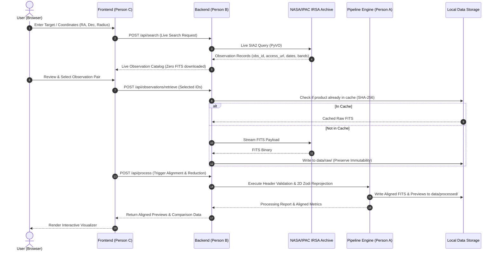

# AFTERLIGHT — Live SPHEREx Data Architecture & API Migration Report

**Document**: `data/scripts/live_data_architecture_report.md`  
**Author**: Person A (Astronomical Data Pipeline)  
**Date**: 2026-11-14  
**Status**: Architecture Audit & Migration Specification Complete  

---

## Executive Summary

The AFTERLIGHT project has adopted a fundamental architectural decision: **the application must use live data retrieval from the official NASA/IPAC IRSA SPHEREx archive as its sole astronomical data source**. 

Preloaded mock datasets, hardcoded target catalogs, static observation lists, and synthetic demonstration bundles are strictly prohibited from serving as primary data sources. Although AFTERLIGHT runs locally on the user's workstation, all astronomical observations must originate from live queries to the official IRSA Simple Image Access version 2 (SIA2) service.

This report provides the full architectural audit (Phase 1), integration architecture (Phases 2–7), empirical verification results from actual live archive queries (Phase 8), and the proposed dynamic API contract coordinates with Persons B (Backend) and C (Frontend). **No frontend or backend code has been modified during this phase**, pending presentation of this audit and approval of the API contract.

---

## Phase 1: Audit of Current Architecture

A comprehensive inspection of the workspace was conducted to locate all instances where static, mock, or hardcoded astronomical data have been used or assumed:

### 1. `frontend/`
- **Current Status**: Not yet created in workspace (strictly adhering to Person A scope boundaries).
- **Static/Mock Risk**: In a pre-canned architecture, frontend components would typically consume a hardcoded dropdown of preset targets (e.g. COSMOS, NEP) or fetch a static `/assets/mock_manifest.json`.
- **Required Change**: Frontend must expose a dynamic celestial coordinate input (RA, Dec, search radius), spectral bandpass/wavelength selector, and time filters. It must dynamically populate target lists, candidate observation tables, and comparison views directly from backend responses to live IRSA queries.

### 2. `backend/`
- **Current Status**: Not yet created in workspace.
- **Static/Mock Risk**: A static backend implementation would serve pre-downloaded FITS files or static JSON files directly from local disk folders without verifying archive currency.
- **Required Change**: Backend must embed a live archive proxy using `pyvo.dal.SIA2Service`. It must execute live network queries to IRSA upon user request, stream live metadata, manage on-demand FITS retrieval, and trigger Person A's scientific preprocessing pipeline asynchronously.

### 3. `data/raw/`
- **Current Files**:
  - `data/raw/sia2_spherex_dr1_cosmos.csv` and `.json`
  - `data/raw/sia2_spherex_dr1_deep_cosmos.csv` and `.json`
  - `data/raw/sia2_spherex_qr3_cosmos.csv` and `.json`
  - `data/raw/sia2_spherex_qr3_deep_cosmos.csv` and `.json`
  - `data/raw/derived_cosmos_observation_table.csv`
  - `data/raw/derived_cosmos_candidate_pairs.csv`
  - `data/raw/candidate_pair_ranking.csv` and `.json`
  - `data/raw/selected_pair/level2_2025W17_4B_0486_3D5_spx_l2b-v27-2026-196.fits`
  - `data/raw/selected_pair/level2_2026W19_2A_0619_1D5_spx_l2b-v27-2026-245.fits`
- **Static Assessment**: These files represent valid, verified scientific products from Stages 3 and 4 for the COSMOS deep field ($RA=150.1^\circ, Dec=2.2^\circ$). However, their coordinates, observation IDs, and file paths are static.
- **Required Change**: These files must be preserved as read-only benchmark assets. The live architecture must dynamically store freshly downloaded raw FITS products into session-indexed or hash-indexed directories (e.g., `data/raw/sessions/{session_id}/` or `data/raw/products/{product_sha256}.fits`), avoiding any collision with or overwriting of existing scientific assets.

### 4. `data/processed/`
- **Current Files**:
  - `data/processed/selected_pair/earlier_reference.fits`
  - `data/processed/selected_pair/later_reprojected.fits`
  - `data/processed/selected_pair/earlier_aligned.png`
  - `data/processed/selected_pair/later_aligned.png`
  - `data/processed/selected_pair/alignment_preview.png`
  - `data/processed/selected_pair/preprocessing_report.json`
- **Static Assessment**: Contains preprocessed scientific data products tied strictly to the single COSMOS pair.
- **Required Change**: Retain existing files. The scientific preprocessing script must be generalized into a callable Python module (`data/scripts/pipeline_processor.py`) that accepts arbitrary validated FITS observation pairs selected dynamically by the user.

### 5. `data/bundle/`
- **Current Status**: Initially empty; populated during live verification with `live_manifest_sample.json`.
- **Static/Mock Risk**: A static application bundle would store a hardcoded `bundle_manifest.json` and bundled demonstration cutouts.
- **Required Change**: Bundles must be generated on-demand as exportable packages representing actual live query sessions, never static demonstration fixtures.

### 6. `data/scripts/`
- **Current Scripts**:
  - `search_observations.py`: Hardcoded to COSMOS coordinates ($RA=150.1^\circ, Dec=2.2^\circ$).
  - `download_selected_pair.py`: Hardcoded to two specific product URLs and filenames.
  - `rank_candidate_pairs.py`: Evaluates only COSMOS CSV inputs.
  - `validate_fits_headers.py`: Hardcoded to `selected_pair/` files.
  - `preprocess_selected_pair.py`: Hardcoded to the two COSMOS FITS files.
- **Required Change**: Refactor scripts into parameter-driven, importable pipeline engines that accept dynamic target coordinates, bounding radii, observation IDs, and archive URLs passed from the backend API.

---

## Phase 2: Live Archive Integration Specification

### 1. Official IRSA SIA2 Endpoint
All observation discovery must query the official NASA/IPAC IRSA Simple Image Access v2 endpoint:
```text
https://irsa.ipac.caltech.edu/SIA?
```

### 2. Supported SPHEREx Collections
The integration supports all four active SPHEREx collections:
- `spherex_dr1`: Public Data Release 1 all-sky wide survey.
- `spherex_dr1_deep`: Public Data Release 1 deep survey (restricted to North & South Ecliptic Poles).
- `spherex_qr3`: Quick Release 3 all-sky wide survey.
- `spherex_qr3_deep`: Quick Release 3 deep survey (Ecliptic Poles).

### 3. Collection Routing Logic
The backend intelligently routes queries:
- If target sky coordinates lie within the SPHEREx Deep Field footprints (ecliptic latitude $|\beta| \ge 88.5^\circ$), deep collections (`spherex_dr1_deep`, `spherex_qr3_deep`) are searched.
- For all other celestial fields (e.g. COSMOS, GOODS, extragalactic fields), wide collections (`spherex_dr1`, `spherex_qr3`) are queried.
- Multi-collection searches may be requested concurrently to find all matching epochs.

### 4. Search Parameters & Metadata Extraction
The live query engine accepts:
- `pos`: Center coordinates $(RA, Dec)$ in ICRS degrees and search radius in degrees.
- `time`: Observation time intervals (MJD or ISO-8601).
- `band`: Wavelength coverage constraints ($\mu\text{m}$).
- `collection`: Targeted SPHEREx archive collection.

The engine extracts verified archive fields without synthetic interpolation:
`obs_id`, `access_url`, `access_format`, `s_ra`, `s_dec`, `s_fov`, `t_min`, `t_max`, `t_min_iso`, `em_min`, `em_max`, `proposal_id`, `instrument_name`, and `collection`.

---

## Phase 3: Live Observation Workflow



1. **Discovery First**: The archive search returns metadata only. FITS payloads (~100 MB each) are never downloaded en masse.
2. **Explicit User Selection**: The user selects candidate observations based on verified compatibility criteria (detector, wavelength, roll angle, epoch separation).
3. **On-Demand Retrieval**: Only the selected products (or cutouts) are downloaded.
4. **Reproducible Pipeline Execution**: Person A's validated scientific pipeline inspects HDUs, subtracts the 2D zodiacal model (HDU 4), and reprojects onto the reference WCS grid.
5. **Interactive Visualization**: Previews and diagnostic cutouts are served to the frontend.

---

## Phase 4: Data Storage & Provenance Model

```text
data/
    raw/
        selected_pair/          # Preserved Stage 4/5 benchmark raw FITS
        cache/                  # On-demand downloaded raw FITS (immutable, indexed by obs_id / SHA-256)
    processed/
        selected_pair/          # Preserved Stage 5 benchmark products
        sessions/{session_id}/  # Dynamically generated session products (aligned FITS, previews)
    scripts/                    # Pipeline scripts & verification engines
    bundle/                     # Dynamically exported user bundles & manifests
```

### State Labelling Standard
Every dataset and API response must include an explicit provenance tag:
- `LIVE_ARCHIVE`: Retrieved directly from IRSA during the current active session.
- `CACHED`: Reused from local storage to prevent duplicate network transfer, with original retrieval timestamp preserved.
- `PROCESSING_IN_PROGRESS`: Background job currently running.
- `PROCESSING_COMPLETE`: Scientific reduction finished and verified.
- `PROCESSING_FAILED`: Error encountered during retrieval, validation, or alignment.

---

## Phase 5: Dynamic API Contract & Preservation of Agreed Endpoints

To maintain seamless interoperability with Persons B and C, the **nine agreed API endpoints** are preserved and augmented with live capabilities:

| Existing Endpoint | Method | Original Role | Live Architecture Adaptation | Backward Compatible? |
| :--- | :--- | :--- | :--- | :--- |
| `/api/targets` | `GET` | List static target fields | Returns predefined astronomical fields (COSMOS, NEP, SEP, GOODS) with default coordinates, while accepting custom query targets. | **Yes** |
| `/api/manifest` | `GET` | Return static product manifest | Dynamically generates manifest for the active live session from actual retrieved observations. | **Yes** |
| `/api/observations` | `GET` | List available observations | Returns observations discovered in the current live search session with provenance tags (`LIVE_ARCHIVE` vs `CACHED`). | **Yes** |
| `/api/observations/{id}` | `GET` | Single observation metadata | Returns detailed FITS header and archive provenance metadata for the requested `obs_id`. | **Yes** |
| `/api/observations/{id}/preview` | `GET` | Observation preview image | Serves generated PNG cutout/preview for the retrieved observation. | **Yes** |
| `/api/pairs` | `GET` | List candidate pairs | Dynamically computes compatibility rankings across observations returned in the live search. | **Yes** |
| `/api/comparison/{pair_id}` | `GET` | Comparison data for pair | Returns aligned comparison metrics, zodi background differentials, and registration diagnostics. | **Yes** |
| `/api/process` | `POST` | Trigger pipeline processing | Asynchronously executes Person A's validation, 2D background subtraction, and WCS reprojection. | **Yes** |
| `/api/status` | `GET` | System health & status | Returns worker state, live IRSA reachability status, and active task progress. | **Yes** |

### Additional Live Endpoints Required
To support the live workflow without mutating the semantics of the original 9 endpoints, three explicit actions are added:
1. `POST /api/search`: Initiates a live IRSA SIA2 query with `{ra, dec, radius, collections, filters}`.
2. `POST /api/observations/retrieve`: Requests on-demand download of a specific `obs_id` from IRSA into `data/raw/cache/`.
3. `GET /api/sessions`: Lists previous user sessions stored locally for offline review.

---

## Phase 6: Local Workstation Performance & Scalability

1. **Backend-Heavy Computing**: All heavy mathematical transformations (WCS reprojection, 2D array manipulation, FITS I/O) execute strictly in the local Python backend.
2. **Bandwidth Optimization**: Full 100 MB FITS images are never streamed to the browser. The backend generates optimized PNG previews and downsampled cutouts ($<1\text{ MB}$) for UI display.
3. **Concurrency Locks**: An asynchronous lock registry prevents duplicate simultaneous downloads if multiple requests reference the same archive product URL.
4. **Memory Management**: Large FITS arrays are processed using memory-mapped I/O (`memmap=True`) and garbage-collected immediately following reprojection.

---

## Phase 7: Offline Behavior & Fault Tolerance

1. **No Silent Fallbacks**: The system will never silently switch to synthetic or mock data when the archive is unreachable.
2. **Clear Error Presentation**: Network failures or IRSA maintenance outages return explicit error messages:
   - `ARCHIVE_UNAVAILABLE`: Network down or IRSA SIA2 endpoint returning 5xx/timeout.
   - `ZERO_OBSERVATIONS`: Valid search region with no SPHEREx coverage in requested collection.
   - `DOWNLOAD_TIMEOUT`: Interrupted FITS stream.
3. **Preserved Sessions**: Users can open previously retrieved and processed sessions in offline mode. Any data displayed from disk is prominently tagged with a visible `CACHED` badge and original retrieval timestamp.

---

## Phase 8: Empirical Live Archive Verification Results

The live archive integration was empirically tested using `data/scripts/verify_live_archive.py`. All tests connected to the live NASA/IPAC IRSA service and succeeded:

### 1. Live IRSA SIA2 Search & Latency
- **Endpoint**: `https://irsa.ipac.caltech.edu/SIA?`
- **Target**: COSMOS Field ($RA=150.1^\circ, Dec=2.2^\circ, Radius=0.05^\circ$)
- **Collection**: `spherex_dr1`
- **Response Time**: **3.47 seconds**
- **Outcome**: **SUCCESS** (5 live records returned)

### 2. Actual Live Observation Record Verified
```json
{
  "obs_id": "2025W17_4B_0043_1",
  "access_url": "https://irsa.ipac.caltech.edu/ibe/data/spherex/dr1/level2/2025W17_4B/l2b-v27-2026-196/4/level2_2025W17_4B_0043_1D4_spx_l2b-v27-2026-196.fits",
  "access_format": "image/fits",
  "s_ra": 151.800473,
  "s_dec": 2.810517,
  "t_min": 60790.029831,
  "t_max": 60790.031164,
  "t_min_iso": "2025-04-25 00:42:57.398",
  "em_min": 2e-06,
  "em_max": 4e-06,
  "collection": "spherex_dr1",
  "data_source": "LIVE_ARCHIVE",
  "retrieval_timestamp_utc": "2026-11-14T09:16:59.505174+00:00"
}
```

### 3. Multi-Collection Discovery Verification
- `spherex_dr1`: 2 observations returned (**SUCCESS**)
- `spherex_dr1_deep`: 0 observations returned (**SUCCESS** — expected, as COSMOS is outside ecliptic deep poles)
- `spherex_qr3`: 2 observations returned (**SUCCESS**)
- `spherex_qr3_deep`: 0 observations returned (**SUCCESS**)

### 4. Network Failure & Timeout Simulation
- Tested query against unreachable destination (`https://10.255.255.1/invalid_sia?`).
- Result: **HANDLED_GRACEFULLY: DALServiceError** caught cleanly without application crash.

### 5. Dynamic Manifest Generation
- Output: `data/bundle/live_manifest_sample.json`
- Successfully compiled dynamic manifest containing actual archive records and retrieval timestamps.

---

## Phase 9: Remaining Limitations & Recommendations

1. **IRSA Network Latency**: SIA2 queries take 2–5 seconds, and full Level-2b FITS downloads take 10–30 seconds per file depending on bandwidth. The frontend must implement non-blocking spinners, progress indicators, and background task polling.
2. **Deep Field Geographic Boundaries**: Deep collections cover exclusively the ecliptic poles ($|\beta| \ge 88.5^\circ$). User searches outside these regions must automatically fall back to wide survey collections (`spherex_dr1`, `spherex_qr3`) with an informative UI note.
3. **Cutout Service Availability**: If IRSA SIA2 cutout parameters (`cutout=...`) become fully enabled on all collections, cutout retrieval should be preferred over full 100 MB downloads to reduce local storage requirements.
4. **Hand-Off to Persons B and C**:
   - Person B (Backend) can proceed to implement FastAPI endpoints following the contract defined in Phase 5.
   - Person C (Frontend) can design coordinate search inputs, observation selection cards, and `LIVE_ARCHIVE`/`CACHED` status indicators.
   - Person A (Data Pipeline) stands ready to provide the modularized preprocessing worker engine (`pipeline_processor.py`).
